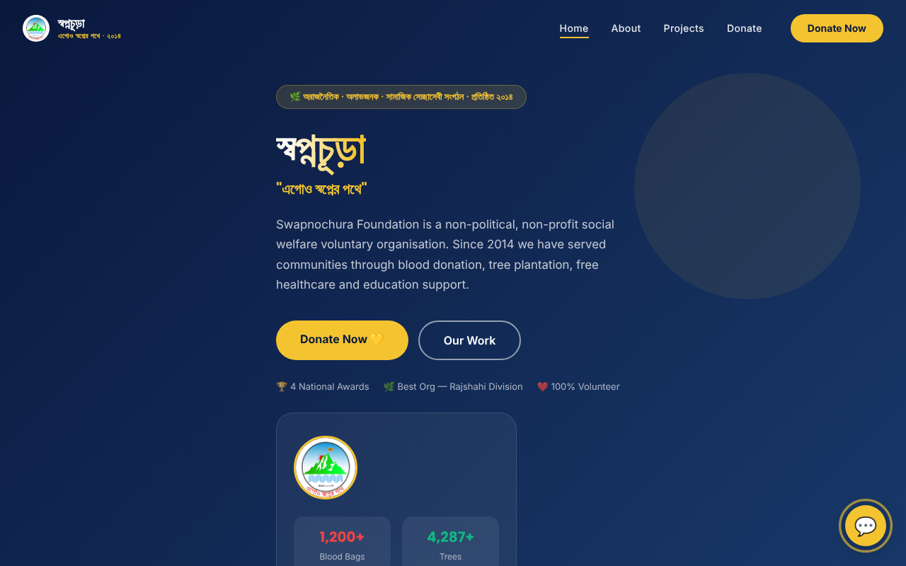

# Swapnochura Foundation website

Website for Swapnochura Foundation (স্বপ্নচূড়া ফাউন্ডেশন), a volunteer-run non-profit in Rajshahi, Bangladesh that has worked on blood donation, tree planting, free health camps and education support since 2014.

**Live site:** https://swapnochura-ngo.vercel.app



## What it does

- **Four pages:** Home, About, Projects and Donate, plus a 404 page, using React Router.
- **Impact numbers:** blood bags collected, trees planted and people treated, shown on the home page.
- **Donate page:** suggested amounts and an animated "fund utilization" breakdown. It is front-end only and does not take payments.
- **Help chatbot ("Swapna"):** answers common questions about blood donation, tree planting, health camps and education with keyword matching, in English and Bangla. It runs fully in the browser, with no backend or AI service.
- **Scroll animations:** sections fade in as you scroll, using a small `useReveal` hook built on IntersectionObserver.
- **Bilingual content:** Bangla and English text, responsive on mobile and desktop.

## Tech stack

| Part | Tool |
| --- | --- |
| UI | React 19 |
| Routing | React Router 7 |
| Styling | Tailwind CSS 3 |
| Icons | lucide-react |
| Build | Vite |
| Hosting | Vercel |

## Run locally

```bash
npm install
npm run dev      # start the dev server
npm run build    # production build into dist/
```

## Project structure

```
src/
  pages/        Home, About, Projects, Donate
  components/   Navbar, Footer, Logo, ChatBot
  hooks/        useReveal (scroll animations)
```

## Author

Built by [Sumaya Binte Saida](https://github.com/Saida0).
